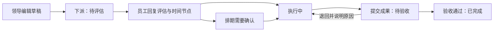

# 工作任务下派与日终同步：功能评估

评估日期：2026-10-24。

> 修订说明：用户已明确该业务是独立的工作任务下发，与项目管理无关，且需要重新划分业务角色。本稿涉及挂靠项目、复用项目任务实体和项目负责人等建议已被后续方案替代。请以《独立工作任务下派与角色权限_修订评估_20261024.md》为后续设计依据。

## 1. 结论

建议在现有系统中建设“工作任务闭环”：编辑、指定人员、评估承诺、执行反馈、成果提交、验收、分角色日终汇总。复用现有账号、项目关联、任务视图、文件界面和微信/邮件队列，新增流程状态、节点承诺、提交验收记录、对象权限和日报调度。

整体属于中等规模功能，主要工作量在流程规则、权限、文件归属和可靠通知。现有通用任务 CRUD 与进度百分比不能直接替代完整业务流程。

本次为需求与技术评估，未修改业务实现、数据库或推送配置，未创建任何真实定时任务或发送消息。

## 2. 成熟方案参考

| 参考产品/能力 | 已公开的成熟做法 | 对本项目的借鉴 |
|---|---|---|
| 飞书任务督办 | 任务负责人、确认人、截止时间、派发提醒、跟进和审核 | 明确“谁执行、谁验收、谁汇总”，通知链接回到任务详情 |
| Asana | 单任务主责人与协作者；审批支持通过、要求修改和拒绝；审批可附成果文件 | 一项任务明确一个主责人；提交完成与验收通过分离；退回有明确意见 |
| Jira 自动化 | 事件触发、条件筛选和定时触发，可按条件汇总发送消息 | 派发/提交/退回实时通知，日终按角色和数据范围汇总，保留自动化执行记录 |
| Hangfire + SQL Server | 持久化后台任务和周期调度，可运行于 Windows Service 等宿主 | 日终汇总调度与任务执行记录；仍通过本系统已有推送队列投递 |

以上是功能模式参考。实际采购这些产品涉及账号、套餐、数据存放和组织接入，本评估不作价格或套餐承诺。

参考原文：

- [飞书任务督办方案](https://www.feishu.cn/content/article/7604785985032883402)
- [Asana 任务类型、负责人和协作者](https://help.asana.com/s/article/different-types-of-tasks?language=en_US)
- [Asana 成果审批](https://help.asana.com/s/article/approvals?language=en_US)
- [Jira 自动化触发器](https://support.atlassian.com/cloud-automation/docs/jira-automation-triggers/)
- [Jira 按条件每日汇总邮件示例](https://support.atlassian.com/automation/kb/automation-for-jira-how-to-create-a-rule-that-sends-the-list-of-issues-that/)
- [Hangfire 周期调度](https://docs.hangfire.io/en/latest/background-methods/performing-recurrent-tasks.html)
- [Hangfire SQL Server 存储](https://docs.hangfire.io/en/latest/configuration/using-sql-server.html)

## 3. 项目现状与差距

| 能力 | 当前代码情况 | 建议处理 |
|---|---|---|
| 基础任务 | ProjectTaskEntity 已有名称、执行人、起止时间、优先级、进度、父子任务和备注 | 复用基础信息与项目关联能力 |
| 任务视图 | 已有任务列表/看板、甘特视图、人员选择和编辑入口 | 增加“我执行、我下派、待我验收、团队总览”，共用任务详情 |
| 任务状态 | ResolveTaskStatus 会把进度 >=100 直接转为状态 3；逾期会转为状态 4；通用状态接口可直接变更状态 | 新流程独立保存业务状态；进度、逾期、阻塞与流程状态分开；避免破坏旧任务统计 |
| 员工评估 | 未见评估结论、回复期限、承诺节点和排期协商记录 | 新增结构化评估与时间节点，不能仅靠备注回复 |
| 成果与验收 | 未见成果提交批次、审核意见和验收通过记录 | 新增提交版本、附件关联和验收记录，保留退回历史 |
| 文件 | ProjectFileEntity 有可选 TaskId，已有上传/下载/预览；上传按原文件名写入项目目录 | 可复用界面，需补任务访问权限、文件唯一存储键和提交版本，防止同名覆盖 |
| 人员关系 | SysUserInfo 使用字符串 UserId；项目有 ManagerUserId；所查用户模型中未见完整直属领导/部门层级 | 先按任务明确选择验收人和汇总领导；项目任务可带入项目负责人，不假设已有组织树 |
| 通知通道 | 已有微信 ClawBot 与邮件队列、收件人查询、投递记录及重试接口 | 复用通道，新增任务通知类型、模板和业务授权校验 |
| 日终同步 | 未见针对该任务流程的角色日报、工作日规则及摘要快照 | 新增业务摘要、调度、去重和补发记录 |

主要依据：

- 后端 `Model/ProjectManage/ProjectManageEntities.cs`、`ProjectManageDtos.cs`。
- 后端 `Service/Project/ProjectManageService.cs`、`calmadmin/Controllers/ProjectManageController.cs`。
- 前端 `src/views/projectmanage/task/index.vue`、`src/views/projectmanage/file/index.vue`。
- 后端 `Interface/WeChatClawBot/IWeChatPushQueueService.cs`、`Interface/Email/IEmailPushService.cs`。

另需处理账号标识兼容：现有任务执行人使用字符串标识，ProjectFile.UploadUserId 则为整数。新流程应统一使用系统 UserId，历史数据通过明确映射兼容，不能直接把字符串账号强转为整数。

## 4. 建议业务流程

### 4.1 编辑与下派

任务至少包含标题、说明、验收标准、优先级、主责人、评估回复期限、领导要求完成时间、验收人、日终汇总领导和交付物要求。

- 建议一个任务只有一个主责人，可增加协作人、关注人。
- 同一工作需要多个人分别评估、分别提交成果时，拆为“一人一条子任务”，汇总到父任务；不能因为其中一人完成就把整项工作算完成。
- 允许任务关联已有项目。日常工作是否允许不挂项目，应在实现前明确；建议支持，避免为日常待办建立虚拟项目。
- 草稿可编辑；已下派任务的内容、负责人、交付要求发生变化时记录版本和通知，关键变化需要员工重新确认。

### 4.2 员工评估与时间节点

员工回复结构化内容：能否承接、评估说明、预计开始时间、承诺完成时间、关键节点及需要协调的事项。

- 将“领导要求的时间”与“员工承诺时间”分别保存。
- 每个节点包括名称、承诺时间、交付要求和当前完成情况。
- 建议符合要求的排期可自动进入执行；超过要求或存在关键节点冲突时进入待确认，由领导确认或调整。
- 无法承接、资料不足或需要协调时必须说明原因，任务返回下派人处理，不能无期限停留。
- 保留原始承诺及每次调整的原因、申请人、确认人和时间；调整日期不能抹掉既有逾期事实。

### 4.3 执行、阻塞与延期

员工可更新进度、节点完成说明和阻塞事项。阻塞需说明原因、需要谁协调及预计恢复时间。延期作为申请处理，不能通过任意改截止时间隐藏问题。

“逾期、即将到期、长时间未更新、被阻塞”应作为提示标签；例如一个任务可以同时是“执行中”和“逾期”，不要让逾期覆盖主流程状态。

日报优先根据任务操作生成，不要求员工另外重复手写一份日报；员工更新的进展和阻塞说明进入对应摘要。

### 4.4 提交成果与验收

员工上传成果文件或图片，填写完成说明，提交一个有版本号的成果批次。领导在该批次上验收通过或退回并说明原因。退回后员工修改、重新提交，旧批次保留。

- 创建任务时配置成果材料必需/可选；有交付物要求时，缺少材料不能提交。
- 可以在执行期间先上传过程材料，提交时明确哪些文件属于正式成果。
- 进度 100% 不自动等于已验收完成。
- 记录实际提交时间、验收时间；员工按时提交后等待领导验收，不继续计算为员工执行逾期。验收超时单独提醒验收人。
- 验收记录绑定具体提交批次，不能让历史批准意见对应到后来替换的文件。

验收属于本评估建议增加的环节；若部分低风险任务不需要验收，可配置提交后自动完成，同时留存该规则和提交记录。

## 5. 分角色消息

### 5.1 即时通知

| 事件 | 接收者 | 核心内容 |
|---|---|---|
| 任务下派/转派 | 新主责人 | 工作要求、评估回复期限、查看入口 |
| 评估回复 | 下派人/验收人 | 承诺节点、是否晚于要求、协调事项 |
| 排期确认/延期结果 | 主责人 | 已确认时间、不同意原因或调整要求 |
| 提交成果 | 验收人 | 完成说明、提交批次、材料入口 |
| 验收通过/退回 | 主责人 | 验收结果、退回原因、后续要求 |
| 阻塞或关键变更 | 指定协调人/领导 | 异常事实及需要采取的行动 |

消息已进入队列、通道发送成功、员工已查看、员工已回复评估是不同事实，分别记录。不能把“微信已发出”当作员工已接单。

### 5.2 每天下班前的不同摘要

推送时间按工作日历和下班时间配置。例如下班时间为 17:30，可以设置 17:00 生成摘要；此时间仅为示例。

| 接收角色 | 应看到的内容 | 不应混入的内容 |
|---|---|---|
| 领导 | 所辖任务概况、今日已验收、今日提交待验收、未回复评估、逾期/延期、明日关键节点、阻塞和需协调事项 | 无权限人员的任务详情；将待验收混计为已验收 |
| 员工 | 自己的待评估任务、今日/明日节点、需要补充的材料、退回修改、待确认延期，以及今日提交/验收通过结果 | 其他员工的个人任务和全团队管理信息 |

本评估将“完成任务的员工”理解为任务执行人员。建议对“仍有待办或当天有提交/验收变化”的员工发送个人摘要，避免未完成任务反而没有提醒；也可配置为仅向当天提交或完成的员工发送。

规则建议：

1. 每位收件人每天每种角色摘要合并为一条，详情通过系统链接查看。
2. 双重身份人员可收到管理摘要与个人摘要，使用不同摘要类型并明确标题。
3. 使用统一统计截点并标注“截至时间”；截点后变化用即时通知或进入下一次摘要。
4. 领导只汇总明确管辖范围；不能仅因为角色叫“领导”就查看所有人的任务。
5. 周末、节假日、加班、夜班、临时调休日历和补发窗口可配置，不能把每天固定 cron 当作工作日历。
6. 队列不可用、微信未绑定或邮箱缺失时记录具体失败/不可达状态；关键通知可按配置备用渠道投递。

## 6. 技术建议

### 6.1 任务流程层

采用明确的业务状态机和流转记录，统一在后端校验操作者、任务归属、当前状态和版本。建议通过现有 Task 关联流程扩展记录，或建立可关联原项目/任务的工作任务实体；保留旧任务的数据和状态语义，避免直接替换旧枚举影响原看板、项目进度和 Agent 工具。

建议数据至少区分：任务主体/参与人、评估及排期版本、节点、进展反馈、成果提交批次、附件、验收记录、操作历史、通知待办、日报快照及投递关联。

网页、批量操作、导入和 Agent 都走同一套服务校验。通用的任务编辑/状态工具不能绕过评估或验收将新流程任务直接置为已完成。

### 6.2 文件层

复用已有文件选择、图片预览等界面，存储时采用唯一文件键与独立数据目录，原文件名只作为显示信息。同名文件不覆盖旧材料，下载和预览按任务权限校验，上传者从当前登录身份取得。

文件大小、数量、格式和图片预览策略可配置。文件保存在发布目录之外，与后续蓝绿部署兼容。

### 6.3 日终调度与消息

建议使用 Hangfire + SQL Server 管理日报调度、执行和失败记录，常驻独立 Worker；现有微信/邮件队列继续承担实际投递。任务业务流转本身仍写业务表，不依赖某个定时任务一直运行。

Hangfire 的周期调度需要服务常驻；服务停机期间的漏发应由业务摘要记录和补发逻辑兜底，不能承诺单靠 cron 永不漏发。

- 状态更新与通知事件在同一数据库事务中落库，再由 Worker 转入现有发送队列，避免任务已保存但通知丢失。
- 日报去重键至少包含应用、业务日期、统计批次、收件人、摘要角色/类型及渠道。重试复用原投递，不重新生成不同内容。
- 定时实例使用租约/领取机制；多进程、蓝绿共存和服务重启时不重复汇总或发送。
- 区分待入队、待发送、发送成功、失败、未知结果等状态。通道超时且无法确认结果时保留不确定状态，不承诺外部消息天然恰好发送一次。
- 对授权撤销、任务转派、人员停用、渠道绑定变化进行投递前复核。已派发任务不随某次推送失败而回滚成未派发。

### 6.4 权限与旧数据兼容

下派人、主责人、协作者、验收人、汇总领导拥有不同操作权限。任务与附件采用对象级授权，明确应用 A/B 归属；查询列表和直接访问详情/下载文件都要检查。

现有用户模型未提供完整组织树时，先显式配置任务的领导/验收人；后续再接部门、直属领导及代理审批。项目负责人可作为默认建议值，但必须校验账号和权限有效。

新增评估时间、实际提交时间、验收时间等应允许为空，未发生不能填当前时间冒充已发生。实体、SQL 可空约束与兼容迁移按现有后端 AGENTS.md 执行。

## 7. 一期范围与实施顺序

一期应完整覆盖本次需求：

1. 任务编辑和下派、主责人/验收人/领导范围及权限。
2. 员工评估、承诺节点、必要的排期确认和进展反馈。
3. 成果文件/图片提交、验收通过/退回、全程留痕。
4. 微信/邮件即时通知，以及领导/员工两套日终摘要。
5. 工作日时间配置、通知去重、失败记录、有限补发、后台多实例保护。
6. PC 操作及手机端评估、进展、拍照/文件上传；手机必须能访问系统入口。

建议先明确状态和权限，再做页面与文件，随后接入调度/通知，最后做端到端试点。二期再扩展复杂多级审批、模板、批量派发、高级负载分析及 AI 辅助摘要。

原始需求当前不需要通用流程设计器。后续出现多部门、多级并行会签、条件分支和复杂组织规则时，再评估完整流程引擎。

## 8. 建议验收场景

以下是待实现后的建议验收用例，本次没有执行，也不标记为通过：

- 下派后主责人能查看、回复评估；他人不能读取、修改或下载附件。
- 超出要求时间的排期进入确认流程，原承诺及变更记录不丢失。
- 同一工作多人分别承接时，每人节点与提交互不覆盖。
- 员工进度 100% 后仍须按配置提交与验收；旧任务统计保持兼容。
- 缺少必需成果时不能提交；退回后新旧材料和验收意见均可追溯。
- 员工按时提交、领导次日验收时，不把等待审核时间计为员工执行逾期。
- 领导与员工在相同截点收到不同范围、不同内容的摘要。
- 多角色人员的两种摘要各生成一次；多实例与重试不生成重复投递。
- 周末、调休、跨日/夜班及临时下班时间调整按规则执行。
- Worker 停机重启后可在设定窗口补发，并保留原摘要截点。
- 通道未绑定、收件人停用、撤权、转派和网络超时均有可追踪结果。
- Agent/直接 API/批量操作不能绕过流程权限与状态检查。
- 历史任务、附件及项目数据迁移后仍可查，无伪造的评估/提交/验收时间。

## 9. 实施前需要确定的业务口径

- 发送渠道：现有微信 ClawBot、邮件，是否还需企业微信/钉钉适配。
- 日终时间、工作日历，以及员工摘要是覆盖所有任务执行人还是仅当天完成者。
- 领导和验收人的来源：每任务指定、项目负责人、直属领导，是否允许多位领导。
- 排期是否均需领导确认，成果是否均需验收，哪些任务可以简化。
- 独立日常任务是否必须关联项目，以及必需成果、允许文件类型/大小等交付规范。
